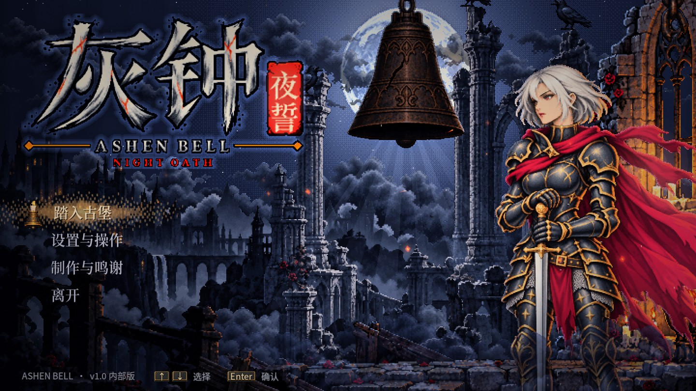
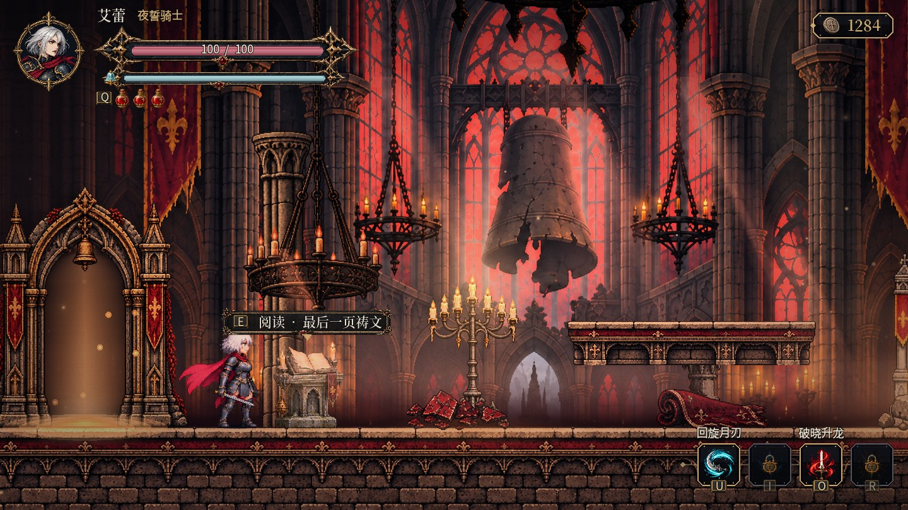
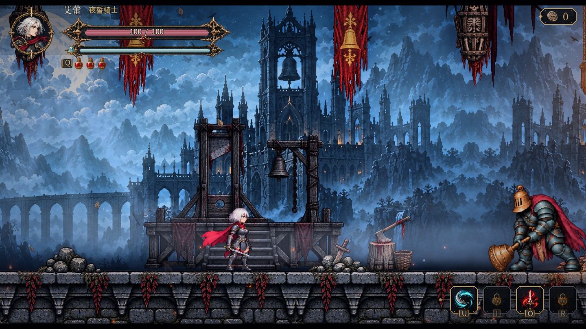
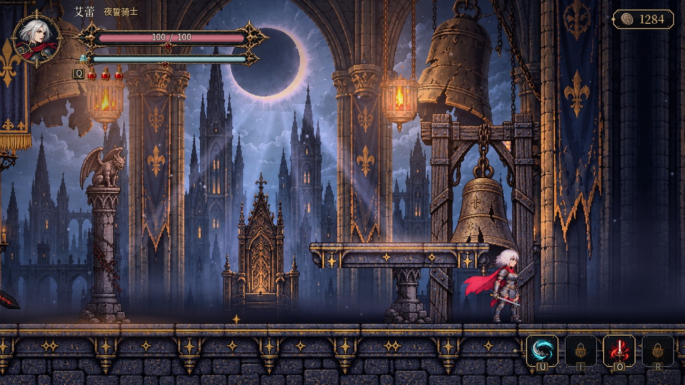

# 灰钟：夜誓 · ASHEN BELL

**v1.0 内部版 · Windows 64 位**

一款哥特像素风横版动作探索游戏。扮演夜誓骑士艾蕾，穿越四片城区、探索相连的房间与支路，击败三位守钟者，让长夜中的古堡重新迎来黎明。

## 下载与游玩

1. 下载 [**灰钟夜誓_v1.0_内部版_Windows.zip**](https://github.com/WZZNNE/Dungeon-all-night/raw/main/%E7%81%B0%E9%92%9F%E5%A4%9C%E8%AA%93_v1.0_%E5%86%85%E9%83%A8%E7%89%88_Windows.zip)（约 287 MB）。
2. 完整解压到本地文件夹（不要在压缩包里直接运行）。
3. 双击 `AshenBell.exe`，在标题画面选择「踏入古堡」。

游戏资源已内嵌在 EXE 中，无需安装、无需联网、无需登录。压缩包内的「游戏说明.txt」有完整的按键与玩法说明。

SHA-256：`bf701d2d570204e86201bdf5e509d603ac73ca09d8f80f24aebc9d0a71541d10`

## 画面

## 游戏内容

- 四片城区、26 个相连房间，隐藏支路与需要新能力才能到达的高台。
- 轻击三段连击、重击、上斩、空中下劈、闪避与精准弹反；命中顿帧、刀光与处决演出。
- 回旋月刃、霜火领域、破晓升龙、终钟共鸣四种技能，二段跳等能力随首领击败逐步解锁。
- 三位守钟者首领，各有入场、二阶段与处决演出。
- 灯台休整、商店与淬炼、护甲、遗物与遗物槽、残火取回、精英敌人与封门战。
- 原创配乐与音效，四首区域曲、三首首领曲。
- 三档难度（旅人 · 轻松 / 夜誓 · 标准 / 苦行 · 挑战），键盘、鼠标与手柄均可游玩，支持改键。

## 基本操作

| 操作 | 键盘 | 手柄（Xbox） |
|---|---|---|
| 移动 | A / D 或 ← / → | 左摇杆 / 十字键 |
| 跳跃（解锁后可二段跳） | 空格 | A |
| 轻击 / 重击 | J / K（或鼠标左 / 右键） | X / Y |
| 闪避 | Shift | B |
| 精准弹反 | L | RB |
| 饮用药瓶 | Q | LB |
| 交互 | E | 轻推上 |
| 技能 | U / I / O / R | LT / 按下右摇杆 / RT / 按下左摇杆 |
| 舆图 / 行囊 | Tab 或 M / V | View / 暂停菜单 |
| 暂停 | Esc | Start |
| 全屏 | F11 | — |

所有按键都可在「设置与操作 → 按键」中修改。

## 配置要求

- Windows 10 / 11 64 位
- 支持 OpenGL 3.3 的显卡
- 约 400 MB 可用空间

存档位置：`%APPDATA%\AshenBellReforged\`

## 许可

游戏使用 Godot Engine 4.7.2（MIT 许可）与思源黑体、思源宋体字形子集（SIL Open Font License 1.1）。许可原文随压缩包附带在 `licenses` 文件夹与「许可与声明.txt」中。
